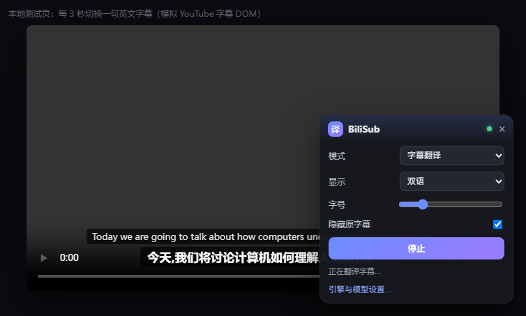

# BiliSub · 双语字幕（Edge 扩展 + 本地引擎）

在浏览器里看外文视频时，**抓取字幕或识别原声**，用**本地模型**实时翻译成中文，以双语字幕浮层显示在视频上。

- 完全本地：模型和翻译都在你自己的电脑上跑，不上传音频与字幕
- 两种来源：视频自带的字幕（质量最好）/ 抓取标签页声音做语音识别（没有字幕时兜底）
- 支持大部分视频网站：YouTube、B 站，以及任何带 `<video>` 的站点
- 可选自定义 API：想更精确时，可切到任意 OpenAI 兼容接口



---

## 一、环境要求

| 项 | 要求 |
| --- | --- |
| 系统 | Windows 10 / 11（64 位） |
| 浏览器 | Edge 116 及以上（Chromium 内核） |
| Python | 3.10 及以上（安装时勾选 “Add python.exe to PATH”） |
| 磁盘 | 约 2 GB（依赖 + 模型） |

## 二、安装（3 步）

1. **双击 `install.cmd`**
   脚本会创建独立 Python 环境、安装依赖、写配置、设置开机自启，并自动打开扩展页。
2. **加载扩展**
   在 `edge://extensions` 打开「开发人员模式」→「加载解压缩的扩展」→ 选择本目录下的 `extension`（安装脚本已把路径复制到剪贴板）。
3. **下载模型**
   点扩展图标 →「引擎与模型设置」→ 按推荐档位点「安装」（默认推荐 OPUS-MT + Whisper small）。

> 引擎默认开机自启。想手动启动时双击 `start-engine.cmd`。

## 三、使用

打开任意视频页，右下角会出现「译」按钮：

| 项 | 说明 |
| --- | --- |
| 模式 · 字幕翻译 | 读取视频自带字幕（或页面字幕 DOM）并翻译，延迟最低、质量最好 |
| 模式 · 原声识别 | 抓当前标签页的声音做语音识别再翻译，适合没有字幕的视频 |
| 显示 | 双语 / 仅译文 / 仅原文 |
| 字号 | 实时调整浮层大小 |
| 隐藏原字幕 | 默认开启，避免中英两套字幕叠在一起 |

**原声识别模式**需要在扩展弹窗里点「开始抓取当前标签页声音」，或按 `Alt+Shift+S`。这是浏览器的安全要求（每次抓音需要一次用户操作），字幕模式不需要。

## 四、模型怎么选

| 模型 | 体积 | 用途 | 说明 |
| --- | --- | --- | --- |
| OPUS-MT 英→中 | 80 MB | 翻译 | 快，适合实时；译文偏直译 |
| NLLB-200 600M | 620 MB | 翻译 | 多语种，质量更好，实时稍慢 |
| Whisper tiny | 80 MB | 语音识别 | 低配机器用 |
| Whisper small | 480 MB | 语音识别 | 推荐，中英平衡 |

设置页会读取你的 CPU / 内存 / 显存自动推荐档位，也可以自己选。模型下载走 `hf-mirror.com`，失败自动切官方源；已下载的文件支持断点续传。

### 自定义模型存储位置

模型体积较大，默认放在安装目录下的 `models`。在「引擎与模型设置 → 模型存储位置」里可以：

- 点「浏览…」选择任意目录（例如 `E:\AI\BiliSub`），点「应用路径」生效
- 勾选「更换目录时移动已下载的模型」，会把现有模型一起搬过去
- 页面会显示该目录已占用空间和所在磁盘剩余空间

路径会写入 `engine/config.json` 的 `models_dir`，重启引擎后依然有效。

## 五、目录结构

```
bili-sub/
├── install.cmd / install.ps1     安装（建环境、装依赖、设自启）
├── uninstall.ps1                 卸载
├── start-engine.cmd              手动启动引擎
├── engine/                       本地引擎（Python）
│   ├── main.py                   WebSocket 服务、协议分发
│   ├── hardware.py               硬件检测与档位推荐
│   ├── models.py                 模型下载 / 校验 / 断点续传
│   ├── mt.py                     翻译提供者（OPUS / NLLB / OpenAI）
│   ├── asr.py                    语音识别（faster-whisper）
│   └── catalog.json              模型清单
├── extension/                    浏览器扩展（Edge）
│   ├── manifest.json
│   ├── background.js             引擎连接、音频捕获、消息路由
│   ├── content/                  浮层、面板、字幕采集
│   ├── offscreen/                音频处理（AudioWorklet 降采样）
│   ├── options/                  设置与模型管理
│   └── popup/                    工具栏弹窗
├── models/                       模型（安装后生成）
└── docs/                         说明文档
```

## 六、常见问题

**扩展显示“本地引擎未连接”？**
双击 `start-engine.cmd`，看窗口里是否打印 `ws://127.0.0.1:8765`。端口被占用可在 `engine/config.json` 改 `port`。

**原声识别点了没反应？**
抓音必须由用户触发：请在扩展弹窗里点按钮，或按 `Alt+Shift+S`；同一标签页保持前台。

**字幕抓不到？**
部分站点把字幕渲染在 canvas 里（如 Netflix 等 DRM 内容），这类无法读取；优先换用原声识别模式（DRM 内容同样拿不到声音）。

**翻译很慢 / 卡顿？**
首次翻译要加载模型（1–3 秒）；之后每句 100–300 ms。CPU 较弱时选 OPUS-MT。

**画中画（PiP）里没有字幕？**
PiP 是独立的置顶窗口，扩展无法在其上绘制，这是浏览器限制。

## 七、隐私

- 默认全部本地：音频、字幕、译文都不离开本机
- 只有切到「自定义 API」时，字幕文本才会发送到你填写的服务端
- 引擎只监听 `127.0.0.1`，并校验请求来源是浏览器扩展

## 八、已知限制

- DRM 视频（Netflix / Disney+ 等）无法抓字幕、抓音也可能拿到静音
- 原声识别每次开始需要一次用户操作（浏览器安全模型）
- 实时识别为 2 秒分块，延迟约 2–3 秒；字幕模式几乎无延迟
- 首次下载模型需要网络（约 80–620 MB）

## 九、开发

引擎与扩展通过 WebSocket 通信，协议版本为 `v1`：

```
握手:  {"v":1,"type":"hello"} → {"v":1,"type":"welcome","hardware":{...},"models":[...]}
翻译:  {"v":1,"type":"translate.batch","id":1,"texts":["..."],"src":"en","tgt":"zh"}
模型:  {"v":1,"type":"models.list"} / {"v":1,"type":"models.download","model":"..."}
识别:  {"v":1,"type":"stt.start"} + 二进制 PCM(16k/s16le) → {"type":"caption",...}
```

测试脚本在 `tools/`：`engine-test.mjs`（引擎联调）、`ext-test.mjs`（扩展端到端）、`serve-fixture.mjs`（本地测试页）。

## 十一、0.2 更新：模式、语言与 GPU

**三种工作模式**（面板顶部切换）：

| 模式 | 行为 |
| --- | --- |
| 智能 | 先读字幕（B 站走官方字幕接口预读，其他站点读 DOM / textTracks）；4 秒内没有字幕就自动转「听声」 |
| 字幕 | 只读字幕并翻译，没字幕会提示切换 |
| 听声 | 抓标签页声音做实时识别 + 翻译（需要先点一次工具栏图标或按 `Alt+Shift+S` 授权） |

**语种**：英语 / 中文 / 法语 / 俄语 / 日语 / 韩语。选「中文」时不再翻译，直接把识别到的中文显示成字幕（适用于中文没有字幕的视频）。

**模型分工**：实时用 OPUS（约 50ms/句），高质量用 NLLB-600M（约 450ms/句）。面板里的「高质量模式」开关控制用哪一个。非英语语种会自动走高质量模型。

**听声模式**：实时语音识别用 Whisper **tiny**（约 300ms/2 秒音频，RTF 0.15），静音 400ms 自动切句，识别跟不上时会丢弃积压音频保证不越拖越慢；高质量识别仍可用 Whisper small（设置里的 `asr.model`）。

**GPU 说明**：CTranslate2 在 Windows + AMD 上不支持显卡加速，本地 OPUS/NLLB 只能跑 CPU。要利用 RX 6750 的算力有两条路：

- **Ollama（Vulkan）**：已验证能识别 AMD 显卡（10 GiB）。设置页可切到「Ollama（本机 GPU）」，需要先 `ollama pull qwen2.5:7b`（约 4.7 GB）。7B 模型的译文质量明显好于 NLLB-600M，但每句约 0.5–1.5 秒，适合高质量模式。
- **whisper.cpp Vulkan**（语音识别 GPU 加速）：尚未接入，作为后续优化项。

多语种扩展方面，NLLB 本身覆盖 200 种语言，协议里的 `src/tgt` 已经是通用字段，增加语言只需在 `content.js` 的语言下拉里加选项，并在 `mt.py` 里补语言代码映射。法语、俄语、日语、韩语已在引擎侧验证可用（NLLB 通道）。

## 十、许可

本项目代码以 **MIT** 许可发布，见 `LICENSE`。

仓库**不包含模型权重与运行时依赖**（`models/`、`engine/.venv/`、`engine/config.json` 已在 `.gitignore` 中排除），首次运行时由安装脚本下载/生成。

所用模型遵循各自许可：

| 模型 | 许可 |
| --- | --- |
| OPUS-MT（英→中） | CC-BY 4.0 |
| Whisper tiny / small / distil | MIT |
| Qwen2.5-7B（Ollama） | Apache-2.0 |

商用前请自行确认所用模型的条款。
